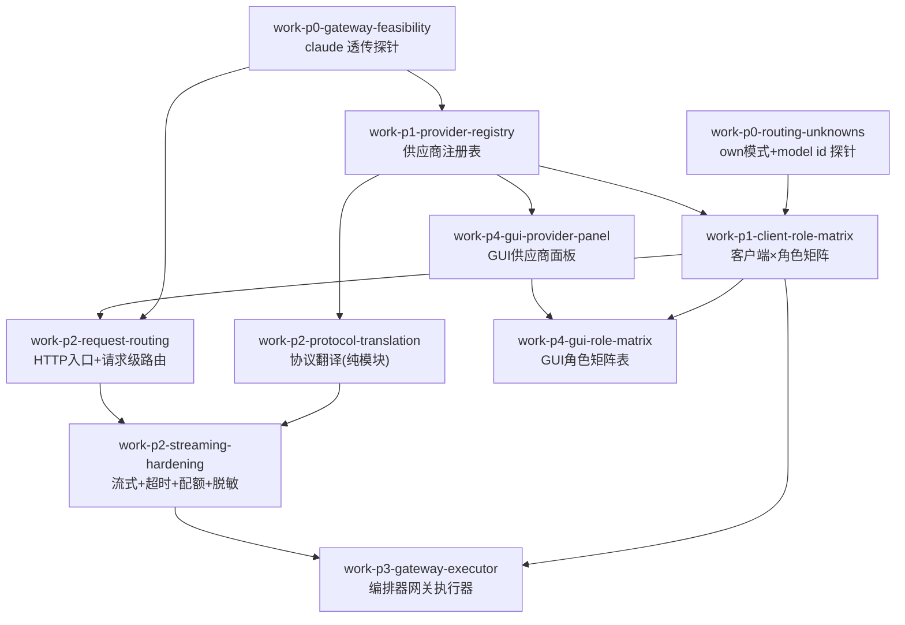

# AIOS 本地 LLM 网关 + 可配置模型路由 — 正式实施计划

- 日期：2026-11-13
- 工作项：`gateway-model-routing`
- 规划 Activation：`267beb00-61a9-4d4c-bf8d-6c1be2b8247c`（rex-harness `software.planning.sequence`）
- 上游决策：ADR 0007 二期 · 决策 8（本地 LLM 网关 + 请求级智能路由 + 实时路由图）
- 状态：ready（计划已成形，待按 frontier 执行；本文件不含实施）
- 机器可校验工件：[`2026-11-13-gateway-model-routing-delivery-ticket.json`](2026-11-13-gateway-model-routing-delivery-ticket.json)（`rex.delivery-ticket.v1`，经 `normalizePlanningArtifact` 校验）

> 北极星：角色/意图显式声明，代码不猜意图。单一配置源：CLI / GUI / 网关读写同一份。复用而非重造。密钥只引用 env、不落明文、不提交。

---

## Decision Ticket

`decisionTicketRef: artifact:decision-ticket:gateway-model-routing`

本节是独立的决策记录（不是第二份实施计划）。下列决策已在 `/grill` 与 ADR 0007 收敛，本计划只执行、不重新解释。

### D1 — 感知面与能力进程分离，网关是执行传输层
AIOS 自有感知面（ADR 0007 决策 1/3）。网关是「能力进程」的请求面：HTTP 入口持有路由/协议翻译/可用性判断；TUI、浏览器面板、桌面壳都是它的视图。**plan-and-solve 编排器保留**，但改为通过 HTTP 驱动网关，不再逐阶段 spawn 冷进程。

### D2 — 四层配置链（自底向上）
1. **供应商注册表**（地基）：用户可配 endpoint / 密钥（env 引用）/ 协议 / 供应模型。
2. **客户端 × 角色 → 模型矩阵**：全局默认 + 每客户端覆盖；plan/review 用强模型、implement 用便宜模型；**所有角色（含 implementer）都可自由配置**。
3. **网关核心**：HTTP 入口 + claude/openai/gemini 协议翻译 + 按 (客户端,角色)→模型→供应商 的**请求级**路由 + 流式 + 每请求超时 + 可用性/配额感知 + 脱敏。
4. **GUI 设置面**（apps/shell）：客户端×角色矩阵表 + 供应商面板，读写**同一份**配置。

### D3 — 任务级路由 ≠ 请求级路由（不可互替）
现有 `resolveModelForRole` 是**任务级**（哪个角色用哪个模型）。网关新增的是**请求级**（这次请求走哪个 provider/账号/通道）。两者叠加：矩阵决定「角色→模型」，网关决定「模型→可用通道」。ADR 0007 决策 8 已明确二者不是同一件事。

### D4 — 协议翻译是跨客户端自由分配的关键
没有翻译，原生协议不兼容会 401（历史上 provider 字段混淆「上游厂商」与「可启动客户端」已致 pi worker 401）。翻译层让任意 relay 客户端可被分配任意供应模型。复用 `MODEL_PROTOCOLS`（`openai-chat`/`openai-response`/`claude`/`gemini`）与 `protocolEndpoint(protocol, base)`。

### D5 — relay / own 双模式边界
- **relay 客户端**（claude/codex/opencode/hermes）：可被网关分配模型（改 base URL 即可）。
- **own 客户端**（gemini/grok）：账号绑定，endpoint 覆盖未验证。**接网关需单独探针，不打包票**（见 work-p0-routing-unknowns）。探针结论可能为「不可」，据此把它们排除出网关路由范围。

### D6 — 单一配置源 + 密钥安全
CLI / GUI / 网关读写同一份配置（供应商注册表 + 矩阵）。密钥以 `env:VAR` 引用，运行时解析，**绝不写明文、绝不提交、绝不在 GUI 回显**。上游转发前脱敏。

### D7 — GUI 落点与硬约束（apps/shell）
- 设置页放 `apps/shell/ui/src/app/(console)/` 子路由（不往 `ui/` 顶层加目录）。
- 取数走子进程 `apps/shell/data/load.mjs`，**不直接 import `scripts/lib/**`**（会触发 Turbopack 整仓 trace）。
- 展示词表/事实走 `apps/shell/ui/src/lib/console-facts.ts` 与 `src/lib/config`；视觉 token 与 docs-site 共用（测试钉住）。
- 入口走根 `aios ui`（`scripts/aios-ui.mjs`）。界面零手写常量，事实只从 data 平面出。

### D8 — 复用而非重造（已验证锚点）
| 能力 | 真实锚点 | 复用方式 |
|---|---|---|
| 角色→模型解析 | `scripts/lib/tooling/model-router/routing/selection.mjs:211` `resolveModelForRole` | 矩阵解析直接复用 |
| 客户端契约/协议兼容 | `selection.mjs:90` `applyClientContract`、`:29` `clientModelCompatibility`、`:45` `evaluateModelChain` | 请求级路由的兼容过滤 |
| 协议词表/端点 | `routing/protocols.mjs:4` `MODEL_PROTOCOLS`、`:28` `protocolEndpoint`、`:9` `normalizeModelProtocol` | 翻译层 + 供应商 endpoint（base 改为可配） |
| 可用性/配额状态机 | `routing/availability.mjs:127` `effectiveAvailability`、`:159` `loadModelAvailability`、`:169` `recordModelAvailability`、`:196` `availabilityForModel` | 通道选择 + 配额耗尽切换 |
| 可插拔阶段执行器 | `orchestration/orchestrator/planning/plan.mjs:29` `resolvePhaseExecutorSelection` | 注册网关执行器，替换 spawn |
| 数据平面 | `apps/shell/data/load.mjs` + `matrix.mjs`/`sources.mjs` | GUI 取数子进程通道 |
| GUI 入口 | `scripts/aios-ui.mjs` | 根 `aios ui` |

### 已确认的现状缺口（实测，非假设）
- `model-registry.json` **无 `providers` 段**（`routingRules`:671 / `roleDefaults`:792 / `signalRules`:846 死配置 / `protocolPaths`:1104 死配置）→ 供应商注册表是 P1 新增。
- `protocols.mjs:6` `RELAY_BASE_URL` 硬编码 `https://coding.rexai.top` → P1 改为按供应商可配。
- 现 `routingRules` 把 planning 指向便宜模型，与「plan/review 用强模型」意图相反 → P1 矩阵按可配置意图纠正。
- 无 HTTP 请求面（入口/流式/工具调用透传/请求级路由）→ P2 新增。
- 逐阶段 spawn 冷 CLI（`subagent-runtime.mjs:113` 默认 10 分钟超时 × N 阶段串行）是卡死根因 → P3 网关执行器根治。
- GUI 尚无路由/供应商设置面 → P4 新增。

### 未决 / 需探针（不凭空关闭）
- **gemini/grok 接网关能力**（own 模式）：work-p0-routing-unknowns 给类型化结论。
- **Qwen / gpt-6.1-sol 真实 model id + relay 是否供应**：注册表里没有（只有 `gpt-5.6-sol`），需真实 id + relay 握手确认，**不凭空写**。零成本部分（relay 模型列表/文档）先查；需扣费确认的部分标 `pending-manual-verification` 并写明原因。

### 后果
- 实时路由图（ADR 0007 二期）**后置**：网关决策留痕是其数据源。本计划只确保 P2 产生决策记录，视图本身不在 P0–P4 关键路径（见「Deferred」）。
- 网关执行器保留 spawn 执行器作为**可回退**路径（两扇门），不一次性删旧路。
- 引用 magpie 只取其核心思路（本地网关/会话级选择/配额感知/脱敏），**不部署 magpie、不抄其前端栈**。

---

## Objective & scope

把已收敛的四层链落成**可执行工作项图**（P0–P4），每个工作项是一个能产生可验证结果的纵向切片，带验收标准、验证命令/证据、失败回退点与真实依赖。本计划**只规划，不实施**。

范围内：P0 探针、P1 配置地基、P2 网关核心、P3 编排器网关执行器、P4 GUI 设置面。
范围外（Deferred）：实时路由图视图、插件进程隔离、签名/公证（ADR 0007 S4）。

---

## Dependency graph

**最短关键路径**（决定总工期）：
`work-p0-gateway-feasibility → work-p1-provider-registry → work-p1-client-role-matrix → work-p2-request-routing → work-p2-streaming-hardening → work-p3-gateway-executor`

**并行边界**（不强行串成流水线）：
- P0 两个探针互相独立，可并行。
- P1 完成后，三条track独立推进：协议翻译（纯模块）、请求级路由、GUI 供应商面板——彼此无依赖路径，汇合于流式加固与 GUI 矩阵。
- GUI track（P4）只依赖 P1 配置层，**可与 P2/P3 并行**，不必等网关跑通。

---

## Work items

每项含：observable outcome / 验收标准（completion criteria）/ 验证（verification）/ 失败回退点 / 依赖。验收标准是硬门，验证命令是证据来源。

### work-p0-gateway-feasibility
- **标题**：最小 claude-only 透传网关探针（P0，可逆，1–2 天）
- **Outcome**：一个真实 claude 客户端会话，`ANTHROPIC_BASE_URL` 指向本地 `127.0.0.1` 网关，经网关透传到 relay，单轮端到端完成（含流式），不卡死；网关留下请求决策记录。
- **验收标准**：
  - 一个真实 claude 会话经网关→relay 完成单轮往返，流式 token 正常返回。
  - 实测单轮 wall-time 与直连 relay 基线同量级（无 10 分钟级卡死）。
  - 探针可逆：env 翻回直连即恢复，无残留进程锁定安装树（CWD 不在安装树内）。
  - 产出探针报告（含实测延迟、决策记录样例、是否可行的类型化结论）。
- **验证**：探针脚本 + `rex-harness receipt --root . -- <probe-command>`（零退出回执）；报告落 `docs/plans/`。
- **回退点**：若网关透传不可行或卡死复现 → 停止 P1+，回到 ADR 重新评估传输层（不强行建网关）。
- **dependsOn**：[]（ready）

### work-p0-routing-unknowns
- **标题**：路由未知项探针（own 模式 + 真实 model id）
- **Outcome**：一份类型化范围结论：哪些客户端可被网关路由（gemini/grok own 模式 endpoint 覆盖是否生效），以及 Qwen / gpt-6.1-sol 的真实 id 与 relay 供应情况。
- **验收标准**：
  - gemini/grok 各给 `can` / `cannot` / `conditional` 之一的真实握手结论（不打包票）。
  - 每个候选 model id 要么经 relay 模型列表/握手确认，要么标 `unavailable`；**无凭空 id 进入注册表**。
  - 需扣费的确认项标 `pending-manual-verification` 并写明原因；零成本部分照常实测。
- **验证**：探针报告 + 可用零成本证据的 `receipt:`；扣费项以 `pending-manual-verification` 记录。
- **回退点**：own 模式不可行 → 把 gemini/grok 排除出网关路由范围（矩阵标 not-assignable），不阻塞 relay 客户端主线。
- **dependsOn**：[]（ready，与 feasibility 探针独立）

### work-p1-provider-registry
- **标题**：用户可配供应商注册表（单一配置源·地基）
- **Outcome**：配置新增 `providers` 段（endpoint / env 密钥引用 / 协议 / 供应模型），可加载/校验；`protocolEndpoint` 的 base 由硬编码改为按供应商可配；CLI 可 list/add/doctor 供应商。
- **验收标准**：
  - 注册表 schema 校验通过；非法配置 fail-closed（退出码非零），不静默跑默认。
  - 密钥以 `env:VAR` 引用，运行时解析；配置文件与 GUI 输出**均无明文密钥**。
  - CLI / 网关 / GUI 读同一份注册表（单一源测试钉住）。
  - 复用 `MODEL_PROTOCOLS` / `normalizeModelProtocol`，不另造协议词表。
- **验证**：`node --test scripts/tests/tooling/model-router/provider-registry.test.mjs`（新增）+ `aios model-router providers doctor` 的 `receipt:`。
- **回退点**：schema 不收敛 → 保留现有 `RELAY_BASE_URL` 默认作为单供应商特例，注册表 additive 引入。
- **dependsOn**：[work-p0-gateway-feasibility]

### work-p1-client-role-matrix
- **标题**：客户端 × 角色 → 模型矩阵（全局默认 + 每客户端覆盖）
- **Outcome**：矩阵配置可解析 (客户端, 角色) → 模型 → 供应商；全局默认 + 每客户端覆盖；所有角色（含 implementer）可配；纠正现 routingRules 的 planning→便宜模型。
- **验收标准**：
  - 每个 relay 客户端 × {planner, implementer, reviewer, team-lead, team-member} 都能解析出模型。
  - 每客户端覆盖优先于全局默认；env 覆盖（`AIOS_MODEL_<ROLE>`）仍最高优先。
  - own 模式客户端按探针结论标 not-assignable，不被强行分配。
  - 复用 `resolveModelForRole` / `applyClientContract`，不另造解析器；角色/意图显式声明，无声明回落中性默认（不猜）。
- **验证**：`node --test scripts/tests/tooling/model-router/client-role-matrix.test.mjs`（新增）+ 现有 selection 测试回归。
- **回退点**：矩阵解析与现有 roleDefaults 冲突 → 矩阵作为 roleDefaults 的超集 additive 落地，保留旧解析路径。
- **dependsOn**：[work-p1-provider-registry, work-p0-routing-unknowns]

### work-p2-protocol-translation
- **标题**：claude/openai/gemini 协议翻译（纯模块，可并行）
- **Outcome**：协议 A 的请求翻译为协议 B 发往上游，响应翻译回 A，含 tool-calls 与 reasoning 透传；纯函数 + 夹具可独立验证。
- **验收标准**：
  - claude ↔ openai-chat ↔ openai-response ↔ gemini 往返保留 messages / tool-calls / reasoning。
  - 夹具照抄真实 wire 响应信封（不是按内层对象臆造），覆盖流式与非流式。
  - 复用 `MODEL_PROTOCOLS` / `protocolEndpoint`；翻译层不持有密钥（脱敏在转发层）。
- **验证**：`node --test scripts/tests/tooling/model-router/gateway/protocol-translation.test.mjs`（新增，真实信封夹具）。
- **回退点**：某协议对翻译不收敛 → 先支持已验证协议对（claude↔openai-chat），其余标 unsupported，不阻塞同协议转发。
- **dependsOn**：[work-p1-provider-registry]

### work-p2-request-routing
- **标题**：网关 HTTP 入口 + 请求级路由 + 可用性/配额选择
- **Outcome**：网关 daemon 接收请求，按矩阵解析 (客户端,角色)→模型，按可用性/配额选可用 provider/通道并转发（先同协议），每请求留下决策记录（实时路由图的数据源）。
- **验收标准**：
  - 一个请求经网关解析到配置的 (客户端,角色) 模型并转发到正确 provider endpoint。
  - down/degraded 通道被跳过（复用 `effectiveAvailability` / `availabilityForModel`）；配额耗尽触发通道切换。
  - 每请求决策记录落盘（模型/通道/原因/可用性快照），可供后续路由图消费。
  - 只绑 `127.0.0.1` + 随机 token；敏感路由拒绝带 `Origin`/`Sec-Fetch-*` 的请求（信任边界）。
- **验证**：`node --test scripts/tests/tooling/model-router/gateway/request-routing.test.mjs`（新增）+ 本地 loopback `receipt:`。
- **回退点**：请求级路由与任务级解析冲突 → 路由层只消费矩阵结果，不改 `resolveModelForRole` 语义。
- **dependsOn**：[work-p1-client-role-matrix, work-p0-gateway-feasibility]

### work-p2-streaming-hardening
- **标题**：流式 + 每请求超时 + 配额故障切换 + 脱敏（集成切片）
- **Outcome**：一个跨协议流式请求经网关完整完成：翻译接入活转发路径、每请求超时、配额耗尽切通道、上游转发前脱敏。
- **验收标准**：
  - 跨协议流式请求端到端完成，token 流不中断、不卡死。
  - 每请求超时生效（取代 10 分钟×N 冷进程串行）；超时返回类型化错误而非挂起。
  - 配额耗尽/通道 down 时按可用性状态机切换，留痕。
  - 密钥/敏感数据在上游转发前脱敏；日志与决策记录不含明文凭据。
- **验证**：`node --test scripts/tests/tooling/model-router/gateway/streaming-hardening.test.mjs`（新增）+ 跨协议流式 loopback `receipt:`。
- **回退点**：流式翻译不稳定 → 降级为非流式 buffered 转发（仍单会话、仍超时封顶），流式作为增强 additive。
- **dependsOn**：[work-p2-request-routing, work-p2-protocol-translation]

### work-p3-gateway-executor
- **标题**：编排器网关执行器（根治冷进程卡死）
- **Outcome**：一个可插拔阶段执行器，通过 HTTP 驱动网关而非 spawn 冷 CLI；工作项各阶段以角色别名（planner/implementer/reviewer→配置模型）经网关执行，单会话顺滑，无 10 分钟×N 卡死。
- **验收标准**：
  - 一个真实多阶段工作项经网关执行器端到端跑通，角色→模型取自矩阵。
  - 实测 wall-time 显著低于 spawn 基线；无逐阶段冷进程。
  - 复用 `resolvePhaseExecutorSelection` 注册执行器；spawn 执行器仍可选作为回退（两扇门）。
  - 执行器 CWD 不在安装树内（不锁 `aios update` 目录替换）。
- **验证**：`node --test scripts/tests/execution/harness/gateway-executor.test.mjs`（新增）+ `rex-harness receipt --root . -- <real-multi-phase-dispatch>`（零退出）。
- **回退点**：网关执行器异常 → 切回 spawn 执行器（保留路径），工作项仍可完成，不阻塞交付。
- **dependsOn**：[work-p2-streaming-hardening, work-p1-client-role-matrix]

### work-p4-gui-provider-panel
- **标题**：GUI 供应商面板（apps/shell，读写单一源）
- **Outcome**：设置屏列出/新增/编辑供应商（endpoint / env 密钥引用 / 协议 / 供应模型），写入 CLI/网关读的同一份配置。
- **验收标准**：
  - 供应商 CRUD 经数据平面（`apps/shell/data/load.mjs` 子进程 + 写 action），不直接 import `scripts/lib`。
  - env 引用密钥**绝不回显明文**；own/untrusted 标记可见。
  - 设置页落 `src/app/(console)/` 子路由；视觉 token 与 docs-site 共用（测试钉住）；界面零手写常量。
  - 真实浏览器冒烟：golden path + 空/错误/加载态。
- **验证**：`npm run ui:typecheck && npm run test:shell` + 浏览器冒烟（截图 + DOM 断言）。
- **回退点**：写路径不收敛 → 先只读面板（读单一源），写操作 additive 引入。
- **dependsOn**：[work-p1-provider-registry]

### work-p4-gui-role-matrix
- **标题**：GUI 客户端×角色矩阵表（apps/shell）
- **Outcome**：矩阵表（客户端 × 角色）每格可分配模型 + 全局默认 + 每客户端覆盖，读写同一份配置。
- **验收标准**：
  - 矩阵从真实配置事实渲染（无手写常量），编辑持久化到单一源。
  - relay / own 模式区分可见；own 客户端标 not-assignable。
  - 复用供应商面板建立的设置路由 + 数据平面写模式（共享状态，不另造）。
  - 真实浏览器冒烟：改一格→持久化→重渲染一致；空/错误/加载态。
- **验证**：`npm run ui:typecheck && npm run test:shell` + 浏览器冒烟（截图 + DOM 断言）。
- **回退点**：矩阵编辑不收敛 → 先只读矩阵展示，编辑 additive。
- **dependsOn**：[work-p1-client-role-matrix, work-p4-gui-provider-panel]

---

## Frontier

每轮重排的 ledger 起点。所有工作项恰好分类一次。

- **Ready（可立即开始）**：`work-p0-gateway-feasibility`、`work-p0-routing-unknowns`
- **Blocked（等待依赖，附原因）**：
  - `work-p1-provider-registry` ← 等 feasibility 探针确认网关可行
  - `work-p1-client-role-matrix` ← 等注册表 + 路由未知项探针定范围
  - `work-p2-protocol-translation` ← 等注册表的协议/endpoint 模型
  - `work-p2-request-routing` ← 等矩阵 + feasibility 探针
  - `work-p2-streaming-hardening` ← 等请求路由 + 协议翻译汇合
  - `work-p3-gateway-executor` ← 等流式加固 + 矩阵
  - `work-p4-gui-provider-panel` ← 等注册表（配置层即可，不必等网关）
  - `work-p4-gui-role-matrix` ← 等矩阵配置 + 供应商面板共享路由

## Parallel groups

真实独立边界（无重叠、无伪造依赖）：
- **Group A（P0 探针）**：`work-p0-gateway-feasibility` ∥ `work-p0-routing-unknowns`
- **Group B（P1 后三track）**：`work-p2-protocol-translation` ∥ `work-p2-request-routing` ∥ `work-p4-gui-provider-panel`

其余为关键路径上的串行汇合，不强行并行。

## Convergence gate

- **joinCondition**：P0–P4 全部完成——网关执行器以配置的角色→模型路由跑通一个真实多阶段工作项且无冷进程卡死；GUI 与 CLI/网关读写同一份配置；密钥全程 env 引用、不落明文。
- **verification**：`node --test scripts/tests/tooling/model-router/provider-registry.test.mjs scripts/tests/tooling/model-router/client-role-matrix.test.mjs scripts/tests/tooling/model-router/gateway/*.test.mjs scripts/tests/execution/harness/gateway-executor.test.mjs && npm run ui:typecheck && npm run test:shell && rex-harness receipt --root . -- <real-multi-phase-dispatch-via-gateway>`
- **requiredEvidenceRefs**：见交付工件 `convergenceGate`（指向本计划汇合节 + 交付工件）；执行期以真实 `receipt:` 与浏览器冒烟证据替换符号引用。

## Acceptance criteria

全局验收（跨工作项硬门）：
1. **顺滑单会话**：真实多阶段工作项经网关执行器跑通，实测 wall-time 显著低于 spawn 基线，无 10 分钟×N 卡死（work-p3 回执）。
2. **可配置角色→模型**：plan/review 强模型、implement 便宜模型，每客户端可自由覆盖，所有角色可配（work-p1-matrix 测试）。
3. **跨客户端自由分配**：跨协议流式请求端到端完成，tool-calls/reasoning 透传（work-p2 测试 + 回执）。
4. **单一配置源**：CLI/GUI/网关读写同一份注册表+矩阵（单源测试）。
5. **密钥安全**：env 引用、运行时解析、转发前脱敏、GUI 不回显、不提交（注册表+脱敏测试）。
6. **可逆/两扇门**：探针可逆；spawn 执行器保留为回退；GUI 写路径可降级只读。
7. **不猜意图**：角色/意图显式声明，无声明回落中性默认（selection 回归）。
8. **不凭空 id**：Qwen/gpt-6.1-sol 经真实确认或标 unavailable/pending-manual（work-p0-routing-unknowns）。

## Deferred（不在 P0–P4 关键路径）

- **实时路由图视图**：ADR 0007 二期，网关决策留痕是数据源。本计划由 `work-p2-request-routing` 确保决策记录存在；视图本身后置，待网关稳定后另起工作项。
- **插件进程隔离 / 签名公证（S4）**：ADR 0007 已后置，不在本范围。

## Reuse map

见 Decision Ticket D8 表（全部锚点已实测存在）。死配置 `signalRules`（registry:846）与 `protocolPaths`（registry:1104）不被任何 .mjs 读取，P1 不依赖它们；协议端点事实以 `protocols.mjs` 的 `protocolEndpoint` 为准。