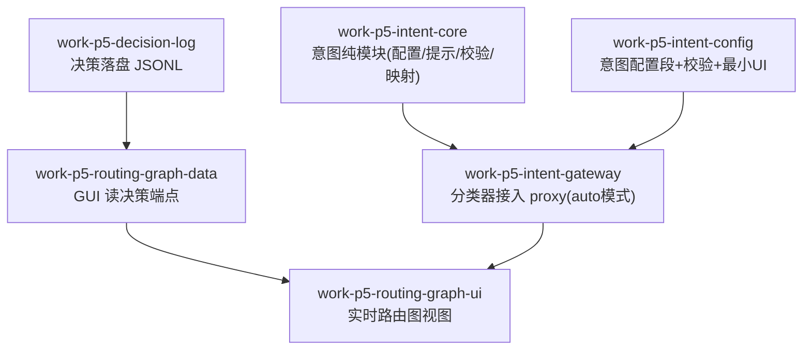

# AIOS 本地 LLM 网关 + 可配置模型路由 — 正式实施计划

- 日期：2026-11-13
- 工作项：`gateway-model-routing`
- 规划 Activation：`267beb00-61a9-4d4c-bf8d-6c1be2b8247c`（rex-harness `software.planning.sequence`）
- 上游决策：ADR 0007 二期 · 决策 8（本地 LLM 网关 + 请求级智能路由 + 实时路由图）
- 状态：ready（计划已成形，待按 frontier 执行；本文件不含实施）
- 机器可校验工件：[`2026-11-13-gateway-model-routing-delivery-ticket.json`](2026-11-13-gateway-model-routing-delivery-ticket.json)（`rex.delivery-ticket.v1`，经 `normalizePlanningArtifact` 校验）

> 北极星：角色/意图显式声明，代码不猜意图。单一配置源：CLI / GUI / 网关读写同一份。复用而非重造。密钥只引用 env、不落明文、不提交。

---

## Decision Ticket

`decisionTicketRef: artifact:decision-ticket:gateway-model-routing`

本节是独立的决策记录（不是第二份实施计划）。下列决策已在 `/grill` 与 ADR 0007 收敛，本计划只执行、不重新解释。

### D1 — 感知面与能力进程分离，网关是执行传输层
AIOS 自有感知面（ADR 0007 决策 1/3）。网关是「能力进程」的请求面：HTTP 入口持有路由/协议翻译/可用性判断；TUI、浏览器面板、桌面壳都是它的视图。**plan-and-solve 编排器保留**，但改为通过 HTTP 驱动网关，不再逐阶段 spawn 冷进程。

### D2 — 四层配置链（自底向上）
1. **供应商注册表**（地基）：用户可配 endpoint / 密钥（env 引用）/ 协议 / 供应模型。
2. **客户端 × 角色 → 模型矩阵**：全局默认 + 每客户端覆盖；plan/review 用强模型、implement 用便宜模型；**所有角色（含 implementer）都可自由配置**。
3. **网关核心**：HTTP 入口 + claude/openai/gemini 协议翻译 + 按 (客户端,角色)→模型→供应商 的**请求级**路由 + 流式 + 每请求超时 + 可用性/配额感知 + 脱敏。
4. **GUI 设置面**（apps/shell）：客户端×角色矩阵表 + 供应商面板，读写**同一份**配置。

### D3 — 任务级路由 ≠ 请求级路由（不可互替）
现有 `resolveModelForRole` 是**任务级**（哪个角色用哪个模型）。网关新增的是**请求级**（这次请求走哪个 provider/账号/通道）。两者叠加：矩阵决定「角色→模型」，网关决定「模型→可用通道」。ADR 0007 决策 8 已明确二者不是同一件事。

### D4 — 协议翻译是跨客户端自由分配的关键
没有翻译，原生协议不兼容会 401（历史上 provider 字段混淆「上游厂商」与「可启动客户端」已致 pi worker 401）。翻译层让任意 relay 客户端可被分配任意供应模型。复用 `MODEL_PROTOCOLS`（`openai-chat`/`openai-response`/`claude`/`gemini`）与 `protocolEndpoint(protocol, base)`。

### D5 — relay / own 双模式边界
- **relay 客户端**（claude/codex/opencode/hermes）：可被网关分配模型（改 base URL 即可）。
- **own 客户端**（gemini/grok）：账号绑定，endpoint 覆盖未验证。**接网关需单独探针，不打包票**（见 work-p0-routing-unknowns）。探针结论可能为「不可」，据此把它们排除出网关路由范围。

### D6 — 单一配置源 + 密钥安全
CLI / GUI / 网关读写同一份配置（供应商注册表 + 矩阵）。密钥以 `env:VAR` 引用，运行时解析，**绝不写明文、绝不提交、绝不在 GUI 回显**。上游转发前脱敏。

### D7 — GUI 落点与硬约束（apps/shell）
- 设置页放 `apps/shell/ui/src/app/(console)/` 子路由（不往 `ui/` 顶层加目录）。
- 取数走子进程 `apps/shell/data/load.mjs`，**不直接 import `scripts/lib/**`**（会触发 Turbopack 整仓 trace）。
- 展示词表/事实走 `apps/shell/ui/src/lib/console-facts.ts` 与 `src/lib/config`；视觉 token 与 docs-site 共用（测试钉住）。
- 入口走根 `aios ui`（`scripts/aios-ui.mjs`）。界面零手写常量，事实只从 data 平面出。

### D8 — 复用而非重造（已验证锚点）
| 能力 | 真实锚点 | 复用方式 |
|---|---|---|
| 角色→模型解析 | `scripts/lib/tooling/model-router/routing/selection.mjs:211` `resolveModelForRole` | 矩阵解析直接复用 |
| 客户端契约/协议兼容 | `selection.mjs:90` `applyClientContract`、`:29` `clientModelCompatibility`、`:45` `evaluateModelChain` | 请求级路由的兼容过滤 |
| 协议词表/端点 | `routing/protocols.mjs:4` `MODEL_PROTOCOLS`、`:28` `protocolEndpoint`、`:9` `normalizeModelProtocol` | 翻译层 + 供应商 endpoint（base 改为可配） |
| 可用性/配额状态机 | `routing/availability.mjs:127` `effectiveAvailability`、`:159` `loadModelAvailability`、`:169` `recordModelAvailability`、`:196` `availabilityForModel` | 通道选择 + 配额耗尽切换 |
| 可插拔阶段执行器 | `orchestration/orchestrator/planning/plan.mjs:29` `resolvePhaseExecutorSelection` | 注册网关执行器，替换 spawn |
| 数据平面 | `apps/shell/data/load.mjs` + `matrix.mjs`/`sources.mjs` | GUI 取数子进程通道 |
| GUI 入口 | `scripts/aios-ui.mjs` | 根 `aios ui` |

### 已确认的现状缺口（实测，非假设）
- `model-registry.json` **无 `providers` 段**（`routingRules`:671 / `roleDefaults`:792 / `signalRules`:846 死配置 / `protocolPaths`:1104 死配置）→ 供应商注册表是 P1 新增。
- `protocols.mjs:6` `RELAY_BASE_URL` 硬编码 `https://coding.rexai.top` → P1 改为按供应商可配。
- 现 `routingRules` 把 planning 指向便宜模型，与「plan/review 用强模型」意图相反 → P1 矩阵按可配置意图纠正。
- 无 HTTP 请求面（入口/流式/工具调用透传/请求级路由）→ P2 新增。
- 逐阶段 spawn 冷 CLI（`subagent-runtime.mjs:113` 默认 10 分钟超时 × N 阶段串行）是卡死根因 → P3 网关执行器根治。
- GUI 尚无路由/供应商设置面 → P4 新增。

### 未决 / 需探针（不凭空关闭）
- **gemini/grok 接网关能力**（own 模式）：work-p0-routing-unknowns 给类型化结论。
- **Qwen / gpt-6.1-sol 真实 model id + relay 是否供应**：注册表里没有（只有 `gpt-5.6-sol`），需真实 id + relay 握手确认，**不凭空写**。零成本部分（relay 模型列表/文档）先查；需扣费确认的部分标 `pending-manual-verification` 并写明原因。

### 后果
- 实时路由图（ADR 0007 二期）**后置**：网关决策留痕是其数据源。本计划只确保 P2 产生决策记录，视图本身不在 P0–P4 关键路径（见「Deferred」）。
- 网关执行器保留 spawn 执行器作为**可回退**路径（两扇门），不一次性删旧路。
- 引用 magpie 只取其核心思路（本地网关/会话级选择/配额感知/脱敏），**不部署 magpie、不抄其前端栈**。

---

## Objective & scope

把已收敛的四层链落成**可执行工作项图**（P0–P4），每个工作项是一个能产生可验证结果的纵向切片，带验收标准、验证命令/证据、失败回退点与真实依赖。本计划**只规划，不实施**。

范围内：P0 探针、P1 配置地基、P2 网关核心、P3 编排器网关执行器、P4 GUI 设置面。
范围外（Deferred）：实时路由图视图、插件进程隔离、签名/公证（ADR 0007 S4）。

---

## Dependency graph

```mermaid
graph TD
  p0f["work-p0-gateway-feasibility<br/>claude 透传探针"]
  p0u["work-p0-routing-unknowns<br/>own模式+model id 探针"]
  p1p["work-p1-provider-registry<br/>供应商注册表"]
  p1m["work-p1-client-role-matrix<br/>客户端×角色矩阵"]
  p2t["work-p2-protocol-translation<br/>协议翻译(纯模块)"]
  p2r["work-p2-request-routing<br/>HTTP入口+请求级路由"]
  p2s["work-p2-streaming-hardening<br/>流式+超时+配额+脱敏"]
  p3e["work-p3-gateway-executor<br/>编排器网关执行器"]
  p4p["work-p4-gui-provider-panel<br/>GUI供应商面板"]
  p4m["work-p4-gui-role-matrix<br/>GUI角色矩阵表"]

  p0f --> p1p
  p0f --> p2r
  p0u --> p1m
  p1p --> p1m
  p1p --> p2t
  p1p --> p4p
  p1m --> p2r
  p1m --> p3e
  p1m --> p4m
  p2t --> p2s
  p2r --> p2s
  p2s --> p3e
  p4p --> p4m
```

**最短关键路径**（决定总工期）：
`work-p0-gateway-feasibility → work-p1-provider-registry → work-p1-client-role-matrix → work-p2-request-routing → work-p2-streaming-hardening → work-p3-gateway-executor`

**并行边界**（不强行串成流水线）：
- P0 两个探针互相独立，可并行。
- P1 完成后，三条track独立推进：协议翻译（纯模块）、请求级路由、GUI 供应商面板——彼此无依赖路径，汇合于流式加固与 GUI 矩阵。
- GUI track（P4）只依赖 P1 配置层，**可与 P2/P3 并行**，不必等网关跑通。

---

## Work items

每项含：observable outcome / 验收标准（completion criteria）/ 验证（verification）/ 失败回退点 / 依赖。验收标准是硬门，验证命令是证据来源。

### work-p0-gateway-feasibility
- **标题**：最小 claude-only 透传网关探针（P0，可逆，1–2 天）
- **Outcome**：一个真实 claude 客户端会话，`ANTHROPIC_BASE_URL` 指向本地 `127.0.0.1` 网关，经网关透传到 relay，单轮端到端完成（含流式），不卡死；网关留下请求决策记录。
- **验收标准**：
  - 一个真实 claude 会话经网关→relay 完成单轮往返，流式 token 正常返回。
  - 实测单轮 wall-time 与直连 relay 基线同量级（无 10 分钟级卡死）。
  - 探针可逆：env 翻回直连即恢复，无残留进程锁定安装树（CWD 不在安装树内）。
  - 产出探针报告（含实测延迟、决策记录样例、是否可行的类型化结论）。
- **验证**：探针脚本 + `rex-harness receipt --root . -- <probe-command>`（零退出回执）；报告落 `docs/plans/`。
- **回退点**：若网关透传不可行或卡死复现 → 停止 P1+，回到 ADR 重新评估传输层（不强行建网关）。
- **dependsOn**：[]（ready）

### work-p0-routing-unknowns
- **标题**：路由未知项探针（own 模式 + 真实 model id）
- **Outcome**：一份类型化范围结论：哪些客户端可被网关路由（gemini/grok own 模式 endpoint 覆盖是否生效），以及 Qwen / gpt-6.1-sol 的真实 id 与 relay 供应情况。
- **验收标准**：
  - gemini/grok 各给 `can` / `cannot` / `conditional` 之一的真实握手结论（不打包票）。
  - 每个候选 model id 要么经 relay 模型列表/握手确认，要么标 `unavailable`；**无凭空 id 进入注册表**。
  - 需扣费的确认项标 `pending-manual-verification` 并写明原因；零成本部分照常实测。
- **验证**：探针报告 + 可用零成本证据的 `receipt:`；扣费项以 `pending-manual-verification` 记录。
- **回退点**：own 模式不可行 → 把 gemini/grok 排除出网关路由范围（矩阵标 not-assignable），不阻塞 relay 客户端主线。
- **dependsOn**：[]（ready，与 feasibility 探针独立）

### work-p1-provider-registry
- **标题**：用户可配供应商注册表（单一配置源·地基）
- **Outcome**：配置新增 `providers` 段（endpoint / env 密钥引用 / 协议 / 供应模型），可加载/校验；`protocolEndpoint` 的 base 由硬编码改为按供应商可配；CLI 可 list/add/doctor 供应商。
- **验收标准**：
  - 注册表 schema 校验通过；非法配置 fail-closed（退出码非零），不静默跑默认。
  - 密钥以 `env:VAR` 引用，运行时解析；配置文件与 GUI 输出**均无明文密钥**。
  - CLI / 网关 / GUI 读同一份注册表（单一源测试钉住）。
  - 复用 `MODEL_PROTOCOLS` / `normalizeModelProtocol`，不另造协议词表。
- **验证**：`node --test scripts/tests/tooling/model-router/provider-registry.test.mjs`（新增）+ `aios model-router providers doctor` 的 `receipt:`。
- **回退点**：schema 不收敛 → 保留现有 `RELAY_BASE_URL` 默认作为单供应商特例，注册表 additive 引入。
- **dependsOn**：[work-p0-gateway-feasibility]

### work-p1-client-role-matrix
- **标题**：客户端 × 角色 → 模型矩阵（全局默认 + 每客户端覆盖）
- **Outcome**：矩阵配置可解析 (客户端, 角色) → 模型 → 供应商；全局默认 + 每客户端覆盖；所有角色（含 implementer）可配；纠正现 routingRules 的 planning→便宜模型。
- **验收标准**：
  - 每个 relay 客户端 × {planner, implementer, reviewer, team-lead, team-member} 都能解析出模型。
  - 每客户端覆盖优先于全局默认；env 覆盖（`AIOS_MODEL_<ROLE>`）仍最高优先。
  - own 模式客户端按探针结论标 not-assignable，不被强行分配。
  - 复用 `resolveModelForRole` / `applyClientContract`，不另造解析器；角色/意图显式声明，无声明回落中性默认（不猜）。
- **验证**：`node --test scripts/tests/tooling/model-router/client-role-matrix.test.mjs`（新增）+ 现有 selection 测试回归。
- **回退点**：矩阵解析与现有 roleDefaults 冲突 → 矩阵作为 roleDefaults 的超集 additive 落地，保留旧解析路径。
- **dependsOn**：[work-p1-provider-registry, work-p0-routing-unknowns]

### work-p2-protocol-translation
- **标题**：claude/openai/gemini 协议翻译（纯模块，可并行）
- **Outcome**：协议 A 的请求翻译为协议 B 发往上游，响应翻译回 A，含 tool-calls 与 reasoning 透传；纯函数 + 夹具可独立验证。
- **验收标准**：
  - claude ↔ openai-chat ↔ openai-response ↔ gemini 往返保留 messages / tool-calls / reasoning。
  - 夹具照抄真实 wire 响应信封（不是按内层对象臆造），覆盖流式与非流式。
  - 复用 `MODEL_PROTOCOLS` / `protocolEndpoint`；翻译层不持有密钥（脱敏在转发层）。
- **验证**：`node --test scripts/tests/tooling/model-router/gateway/protocol-translation.test.mjs`（新增，真实信封夹具）。
- **回退点**：某协议对翻译不收敛 → 先支持已验证协议对（claude↔openai-chat），其余标 unsupported，不阻塞同协议转发。
- **dependsOn**：[work-p1-provider-registry]

### work-p2-request-routing
- **标题**：网关 HTTP 入口 + 请求级路由 + 可用性/配额选择
- **Outcome**：网关 daemon 接收请求，按矩阵解析 (客户端,角色)→模型，按可用性/配额选可用 provider/通道并转发（先同协议），每请求留下决策记录（实时路由图的数据源）。
- **验收标准**：
  - 一个请求经网关解析到配置的 (客户端,角色) 模型并转发到正确 provider endpoint。
  - down/degraded 通道被跳过（复用 `effectiveAvailability` / `availabilityForModel`）；配额耗尽触发通道切换。
  - 每请求决策记录落盘（模型/通道/原因/可用性快照），可供后续路由图消费。
  - 只绑 `127.0.0.1` + 随机 token；敏感路由拒绝带 `Origin`/`Sec-Fetch-*` 的请求（信任边界）。
- **验证**：`node --test scripts/tests/tooling/model-router/gateway/request-routing.test.mjs`（新增）+ 本地 loopback `receipt:`。
- **回退点**：请求级路由与任务级解析冲突 → 路由层只消费矩阵结果，不改 `resolveModelForRole` 语义。
- **dependsOn**：[work-p1-client-role-matrix, work-p0-gateway-feasibility]

### work-p2-streaming-hardening
- **标题**：流式 + 每请求超时 + 配额故障切换 + 脱敏（集成切片）
- **Outcome**：一个跨协议流式请求经网关完整完成：翻译接入活转发路径、每请求超时、配额耗尽切通道、上游转发前脱敏。
- **验收标准**：
  - 跨协议流式请求端到端完成，token 流不中断、不卡死。
  - 每请求超时生效（取代 10 分钟×N 冷进程串行）；超时返回类型化错误而非挂起。
  - 配额耗尽/通道 down 时按可用性状态机切换，留痕。
  - 密钥/敏感数据在上游转发前脱敏；日志与决策记录不含明文凭据。
- **验证**：`node --test scripts/tests/tooling/model-router/gateway/streaming-hardening.test.mjs`（新增）+ 跨协议流式 loopback `receipt:`。
- **回退点**：流式翻译不稳定 → 降级为非流式 buffered 转发（仍单会话、仍超时封顶），流式作为增强 additive。
- **dependsOn**：[work-p2-request-routing, work-p2-protocol-translation]

### work-p3-gateway-executor
- **标题**：编排器网关执行器（根治冷进程卡死）
- **Outcome**：一个可插拔阶段执行器，通过 HTTP 驱动网关而非 spawn 冷 CLI；工作项各阶段以角色别名（planner/implementer/reviewer→配置模型）经网关执行，单会话顺滑，无 10 分钟×N 卡死。
- **验收标准**：
  - 一个真实多阶段工作项经网关执行器端到端跑通，角色→模型取自矩阵。
  - 实测 wall-time 显著低于 spawn 基线；无逐阶段冷进程。
  - 复用 `resolvePhaseExecutorSelection` 注册执行器；spawn 执行器仍可选作为回退（两扇门）。
  - 执行器 CWD 不在安装树内（不锁 `aios update` 目录替换）。
- **验证**：`node --test scripts/tests/execution/harness/gateway-executor.test.mjs`（新增）+ `rex-harness receipt --root . -- <real-multi-phase-dispatch>`（零退出）。
- **回退点**：网关执行器异常 → 切回 spawn 执行器（保留路径），工作项仍可完成，不阻塞交付。
- **dependsOn**：[work-p2-streaming-hardening, work-p1-client-role-matrix]

### work-p4-gui-provider-panel
- **标题**：GUI 供应商面板（apps/shell，读写单一源）
- **Outcome**：设置屏列出/新增/编辑供应商（endpoint / env 密钥引用 / 协议 / 供应模型），写入 CLI/网关读的同一份配置。
- **验收标准**：
  - 供应商 CRUD 经数据平面（`apps/shell/data/load.mjs` 子进程 + 写 action），不直接 import `scripts/lib`。
  - env 引用密钥**绝不回显明文**；own/untrusted 标记可见。
  - 设置页落 `src/app/(console)/` 子路由；视觉 token 与 docs-site 共用（测试钉住）；界面零手写常量。
  - 真实浏览器冒烟：golden path + 空/错误/加载态。
- **验证**：`npm run ui:typecheck && npm run test:shell` + 浏览器冒烟（截图 + DOM 断言）。
- **回退点**：写路径不收敛 → 先只读面板（读单一源），写操作 additive 引入。
- **dependsOn**：[work-p1-provider-registry]

### work-p4-gui-role-matrix
- **标题**：GUI 客户端×角色矩阵表（apps/shell）
- **Outcome**：矩阵表（客户端 × 角色）每格可分配模型 + 全局默认 + 每客户端覆盖，读写同一份配置。
- **验收标准**：
  - 矩阵从真实配置事实渲染（无手写常量），编辑持久化到单一源。
  - relay / own 模式区分可见；own 客户端标 not-assignable。
  - 复用供应商面板建立的设置路由 + 数据平面写模式（共享状态，不另造）。
  - 真实浏览器冒烟：改一格→持久化→重渲染一致；空/错误/加载态。
- **验证**：`npm run ui:typecheck && npm run test:shell` + 浏览器冒烟（截图 + DOM 断言）。
- **回退点**：矩阵编辑不收敛 → 先只读矩阵展示，编辑 additive。
- **dependsOn**：[work-p1-client-role-matrix, work-p4-gui-provider-panel]

---

## Frontier

每轮重排的 ledger 起点。所有工作项恰好分类一次。

- **Ready（可立即开始）**：`work-p0-gateway-feasibility`、`work-p0-routing-unknowns`
- **Blocked（等待依赖，附原因）**：
  - `work-p1-provider-registry` ← 等 feasibility 探针确认网关可行
  - `work-p1-client-role-matrix` ← 等注册表 + 路由未知项探针定范围
  - `work-p2-protocol-translation` ← 等注册表的协议/endpoint 模型
  - `work-p2-request-routing` ← 等矩阵 + feasibility 探针
  - `work-p2-streaming-hardening` ← 等请求路由 + 协议翻译汇合
  - `work-p3-gateway-executor` ← 等流式加固 + 矩阵
  - `work-p4-gui-provider-panel` ← 等注册表（配置层即可，不必等网关）
  - `work-p4-gui-role-matrix` ← 等矩阵配置 + 供应商面板共享路由

## Parallel groups

真实独立边界（无重叠、无伪造依赖）：
- **Group A（P0 探针）**：`work-p0-gateway-feasibility` ∥ `work-p0-routing-unknowns`
- **Group B（P1 后三track）**：`work-p2-protocol-translation` ∥ `work-p2-request-routing` ∥ `work-p4-gui-provider-panel`

其余为关键路径上的串行汇合，不强行并行。

## Convergence gate

- **joinCondition**：P0–P4 全部完成——网关执行器以配置的角色→模型路由跑通一个真实多阶段工作项且无冷进程卡死；GUI 与 CLI/网关读写同一份配置；密钥全程 env 引用、不落明文。
- **verification**：`node --test scripts/tests/tooling/model-router/provider-registry.test.mjs scripts/tests/tooling/model-router/client-role-matrix.test.mjs scripts/tests/tooling/model-router/gateway/*.test.mjs scripts/tests/execution/harness/gateway-executor.test.mjs && npm run ui:typecheck && npm run test:shell && rex-harness receipt --root . -- <real-multi-phase-dispatch-via-gateway>`
- **requiredEvidenceRefs**：见交付工件 `convergenceGate`（指向本计划汇合节 + 交付工件）；执行期以真实 `receipt:` 与浏览器冒烟证据替换符号引用。

## Acceptance criteria

全局验收（跨工作项硬门）：
1. **顺滑单会话**：真实多阶段工作项经网关执行器跑通，实测 wall-time 显著低于 spawn 基线，无 10 分钟×N 卡死（work-p3 回执）。
2. **可配置角色→模型**：plan/review 强模型、implement 便宜模型，每客户端可自由覆盖，所有角色可配（work-p1-matrix 测试）。
3. **跨客户端自由分配**：跨协议流式请求端到端完成，tool-calls/reasoning 透传（work-p2 测试 + 回执）。
4. **单一配置源**：CLI/GUI/网关读写同一份注册表+矩阵（单源测试）。
5. **密钥安全**：env 引用、运行时解析、转发前脱敏、GUI 不回显、不提交（注册表+脱敏测试）。
6. **可逆/两扇门**：探针可逆；spawn 执行器保留为回退；GUI 写路径可降级只读。
7. **不猜意图**：角色/意图显式声明，无声明回落中性默认（selection 回归）。
8. **不凭空 id**：Qwen/gpt-6.1-sol 经真实确认或标 unavailable/pending-manual（work-p0-routing-unknowns）。

## Deferred（不在 P0–P4 关键路径）

- **实时路由图视图**：ADR 0007 二期，网关决策留痕是数据源。本计划由 `work-p2-request-routing` 确保决策记录存在；视图本身后置，待网关稳定后另起工作项。
- **插件进程隔离 / 签名公证（S4）**：ADR 0007 已后置，不在本范围。

## Reuse map

见 Decision Ticket D8 表（全部锚点已实测存在）。死配置 `signalRules`（registry:846）与 `protocolPaths`（registry:1104）不被任何 .mjs 读取，P1 不依赖它们；协议端点事实以 `protocols.mjs` 的 `protocolEndpoint` 为准。

## 交付实录：客户端接入（P0–P4 之后的「最后一公里」）

P0–P4 交付了网关+矩阵，但用户仍无法在自己的 codex / claude code / pi 里真正用上。本节记录补齐的客户端接入与**诚实边界**（2026-11-15）。

### 已交付
- **codex 协议入口**：网关新增 `/v1/responses`（openai-response）。codex 走**同协议直通 + 模型改写**；`registry.clientDefaults.codex` 给它一个 openai-response 默认模型（connect 写入），避免无翻译器时 fail-closed。
- **一键接入 / 断开**：`aios model-router connect [--client claude|codex|pi] [--gateway-url …] [--state-dir …]` 生成可逆配置工件到状态目录（默认 `~/.aios/gateway`），`disconnect` 还原 registry 的 `clientDefaults` 并删除工件。不碰用户 `~/.claude`、`~/.codex`、`~/.pi`。
  - claude：`--settings <stateDir>/claude-settings.json`（合并，保留用户配置）。
  - codex：隔离 `CODEX_HOME`，`wire_api="responses"`、`base_url=<gw>/v1`、`http_headers.x-gateway-client="codex"`。
  - pi：隔离 `HOME`，`models.json` 用 `anthropic-messages` provider 指向网关。
- **零扣费端到端证据**：真实 codex / pi / claude → 网关 → mock 上游全部跑通（模型改写、流式、200）；connect 生成的工件驱动真实 codex 跑通且 disconnect 干净还原。

### 诚实边界（不打包票）
- **协议翻译有边界**：翻译器只覆盖 claude 客户端 ↔ openai-chat / gemini 上游。涉及 openai-response（codex）的跨协议**没有翻译器**，网关 fail-closed 返回 501，绝不静默发错协议 body。计划里「claude/openai/gemini 互转」的表述以本边界为准。
- **配置隔离的代价**：codex 用隔离 `CODEX_HOME`、pi 用隔离 `HOME`，网关会话里暂时看不到用户原有 MCP / 信任目录 / 历史会话；claude 用 `--settings` 合并则保留。这是可逆接入的取舍，不是 bug。
- **真实模型扣费验收**：以上端到端均为 mock 上游（零扣费）。真实供应商扣费验收标 **pending-manual-approval**，需用户显式批准后才跑。

### 真实数据验收（2026-11-15，应用户「mock 能通不代表真实能通」要求）

mock 只证明转发/翻译/接线机制。真实上游验收结论分层：

- **真实端点/鉴权可达**：coding.rexai.top 的 `/v1/models` 带真实 key 返回 200（13 个真实模型）；`/openai/v1/chat/completions`、`/claude/v1/messages`、`/openai/v1/responses` 均真实存在（空 body 返回真实 400/402 校验信封）。
- **真实上游此刻不可用（外部约束，非网关缺陷）**：chat 面真实 completion 返回 **503 "Service temporarily unavailable"**；responses 面返回 **402「本周 Coding 额度已用完、钱包余额不足，2026-11-18 重置」**。因此**真实成功 completion 今天无法演示**，待上游恢复/额度重置/换有额度的 key，标 pending-external。
- **真实数据暴露并已修复的网关 bug**：跨协议时上游非 2xx 被翻译进「空 claude 成功信封」，吞掉真实错误原因。已修（`gateway/proxy.mjs` 上游错误透传分支）+ 回归测试；修复后对真实 503 复验，客户端收到 `{type:"error",error:{message:"Service temporarily unavailable"}}` 且保留 503。同协议错误本就原样透传。
- **结论**：网关机制与客户端接线=mock 实证；真实上游错误处理=真实 503/402 实证；真实成功 completion=待上游可用（pending-external），不打包票。

---

## P5：按意图真 auto + 实时路由图（magpie 对标，2026-11-15）

用户裁定：主界面暂不动，先补 magpie 有、我们没有的两件能力——**按意图真 auto**（每轮让小模型把意图作为结构化判断报出来，路由到对应模型，像 claude code 的 auto）+ **实时路由图**（agent→网关→供应商/模型，带请求/改道/错误计数）。

### 北极星边界（不可违反）
- 意图是**语义判断，由分类器模型报出**（self-report），代码只校验它报的标签是否在配置意图集内、再映射到模型。**绝不**用 `keywordMatches`/正则从用户文本猜意图（`session/signals.mjs` 已钉死此原则）。
- 分类失败/返回未知标签 → **fail-closed 回落**既有候选链，不猜、不静默发错模型。
- 显式角色/模型声明（编排器逐阶段、env 覆盖）**绕过**分类器——显式优先于 auto。
- 分类器每轮多一次小模型调用（成本/延迟，用户已接受）；验证用 **mock 分类器零扣费**，真实扣费验收标 **pending-manual-approval**。

### 现状缺口（实测）
- 决策记录只在 daemon 内存（`serve.mjs` 暴露 `decisions`，CLI gateway 未把 `onDecision` 落盘）→ GUI 独立进程读不到。路由图需先**落盘 JSONL**。
- `resolveGatewayRoute` 是纯函数；异步分类只能在 `proxy.mjs handleIncoming`，结果作为显式 hint 喂回路由。
- 无意图配置段、无分类器、无路由图视图。

### 工作项图

### 工作项与验收
- **work-p5-intent-core**（`routing/intent.mjs`，纯函数）：解析 `registry.intentRouting`（classifierModel + intents[{id,description,modelId}]）、构造分类提示、解析并校验模型报回的 typed 标签、映射 intent→model。验收：未知/缺失标签 fail-closed；绝不关键词匹配；单测覆盖。验证：`node --test scripts/tests/learning/model/model-router-intent.test.mjs`。
- **work-p5-intent-gateway**（`gateway/proxy.mjs`）：auto 模式（无显式角色/模型）且启用意图路由时，经 DI `classifyIntent`（默认真实分类器，测试注入 mock）分类→改写路由模型→决策记录含 intent/classifierModel；工具轮次会话粘性。验收：auto 请求被分类路由；显式声明绕过；分类失败回落；决策留痕。验证：`node --test scripts/tests/learning/model/gateway/model-router-intent-routing.test.mjs`（mock 零扣费）。
- **work-p5-decision-log**（`session/decision-log.mjs`）：JSONL 追加/读取到状态目录，`serve.mjs`/CLI 接 `onDecision`。验收：跨进程可读、日志无密钥、有界滚动。验证：`node --test scripts/tests/learning/model/model-router-decision-log.test.mjs`。
- **work-p5-routing-graph-data**（`apps/shell/ui/src/app/api/model-routing/decisions/route.ts`）：读决策日志→{counters, recent, flow}。验收：读真实日志、脱敏、空/错误态。验证：`npm run test:shell`。
- **work-p5-routing-graph-ui**（`components/console/routing-graph.tsx` + 接入面板）：实时 flow（agent→网关→模型）+ 计数（请求/改道/错误）+ 最近决策 feed，轮询；穷举加载/空/错误/流式态。验收：渲染真实决策、轮询刷新、状态齐全。验证：`npm run ui:typecheck && npm run test:shell` + 浏览器冒烟（截图+DOM 断言）。
- **work-p5-intent-config**（registry `intentRouting` 种子 + `lib/config/model-routing.mjs` 校验 + 最小 UI）：意图描述→模型、分类器模型可配。验收：单一源、env 密钥安全、GUI 可编辑。验证：`npm run test:shell`。

### 汇合门
一个 auto 模式请求 → mock 分类器报意图 → 路由到意图模型 → 决策落盘 → 路由图实时显示该决策与计数。零扣费 mock 实证；真实分类器扣费 = pending-manual-approval。

### 复用而非重造
`normalizeId`/`uniq`（entry/shared）、`getProviderForModel`/`resolveProviderEndpoint`/`resolveProviderApiKey`（routing/providers）、`resolveGatewayRoute` 候选链（gateway/router）、`recordDecision`（proxy）、GUI 数据平面守卫（route.ts 的 hash/备份/校验模式）。**不**复用 `keywordMatches` 做路由。

---

## P5 实施与验证记录（2026-11-15）

结论分层：**mock 实证**（零扣费，已跑通）／**GUI 浏览器实拍**（已跑通）／**真实错误实证**（上一段已修复并回归）／**pending-external / pending-manual-approval**（需真实扣费或上游恢复，未跑）。

### 落地工件
- 意图纯模块 `scripts/lib/tooling/model-router/routing/intent.mjs`：`getIntentRouting` / `buildIntentClassifierPrompt` / `parseIntentLabel(modelOutput, intents)`（二元，结构上看不见用户文本）/ `extractLatestUserText`（工具续轮尾返回 ''）/ `classifyTurnIntent`（openai-chat|claude，max_tokens 64，15s abort，失败→null）。
- 网关接入 `gateway/proxy.mjs`：auto 模式（无显式角色）→ 分类 → intent 置顶候选链（仍过可用性过滤）→ 会话粘性（`x-gateway-session`||clientId||'default'）；决策记录新增 `clientId`+`role`（路由图画 agent→模型 边必需），5 个落账点统一经 `record` 包装注入身份。
- 决策落盘 `session/decision-log.mjs`：JSONL 原子追加（tmp+rename）、500 条上限、敏感键剥离；`serve.mjs`/CLI 三处 stateDir 统一 `--state-dir` > `AIOS_GATEWAY_STATE_DIR` > `~/.aios/gateway`。
- GUI 读侧自包含镜像 `apps/shell/ui/src/lib/config/routing-decisions.mjs`（不 import scripts/lib，避免 Turbopack 全仓 trace）+ 端点 `app/api/model-routing/decisions/route.ts`（limit 钳制 1..100，读失败 423，空≠错误）。
- GUI 视图 `components/console/model-routing/routing-graph.tsx`（纯 SVG，SMIL 虚线动画，`prefers-reduced-motion` 关闭；计数 请求/意图自动路由/错误，**无虚构 rerouted**；最近 8 条 feed）+ `intent-routing-section.tsx`（启用开关、分类器选择按协议过滤、意图行编辑）。
- 配置单一源：builtin + disk registry 同种子（6 意图：quick/implement/review/plan/research/general）；`lib/config/model-routing.mjs` 增 `validateIntentRouting`（分类器须存在且支持 openai-chat|claude、意图 id 唯一非空、modelId 存在）+ `toModelCatalog`；GET 返回 `models` 目录。

### mock 实证（零扣费）
- 单测/集成全绿：`model-router-intent.test.mjs`、`gateway/model-router-intent-routing.test.mjs`（7）、`model-router-decision-log.test.mjs`、`tooling/shell/model-routing-decisions.test.mjs`（8）、`tooling/shell/model-routing-config.test.mjs`（17）。model-router 套件 102/102。
- 汇合门 e2e 探针（仓库外 `$TMPDIR/aios-p5-probe-*`，mock 上游 + fakeroot 配置隔离）：`verdict=PASS`，gateway=54372 mock=54371，`classifierCalls=1`（工具续轮不重复分类），`upstreamModels=[mock-opus, mock-opus, mock-flash]`（新轮→意图 tests→mock-opus；续轮沿用；显式 implementer→mock-flash 绕过分类器），`counters={requests:3,errors:0,autoRouted:2}`，2 条边（claude→mock-opus×2 / claude→mock-flash×1），日志原始字节不含密钥 `probe-key`。

### GUI 浏览器实拍（in-app browser，dev server 指向探针沙箱）
- 路由页 `/routing` 渲染：计数 3/2/0；SVG 节点 claude(3)→本地网关→mock-opus(2)/mock-flash(1)，虚线动画连线；最近 feed 3 行（implementer 紫徽标 / 意图 tests 蓝徽标 / 200 绿 / 延迟 ms）。
- **实时更新**：向网关再发一条用户轮请求 → 一个轮询周期内页面自动增到 `requests:4 / auto:3 / errors:0`、feed 4 行，无需手动刷新。
- 意图段：启用勾选、分类器 glm-5.3-flash、6 个种子意图 id+描述+模型映射全部正确渲染。
- **保存成功**：改 quick 描述 → 保存 → fakeroot registry 落盘（描述带实测后缀），绿色 `已保存：intentRouting`（role=status，#16A34A）渲染在按钮旁；重载后从盘恢复。
- **保存失败**：清空 quick id → 保存 → 红色 `intentRouting.intents[0]: id required`（#DC2626），**未写盘**（quick 仍在、6 意图完整）——校验门端到端有效。
- 控制台无 error；无横向溢出；**真实 disk registry 零泄漏**（探针后缀 `浏览器实测`/`反馈实测` 均未进入，原有「能力画像待实测」等描述属注册表固有文案）。
- 截图：`gui-routing-top.png`（网关解释面板）、`gui-routing-graph.png`（路由图+feed）。

### 本段发现并修复的 UI 缺陷
- **保存反馈不可见**：`message` 原先只渲染在「自定义覆盖」折叠面板内（`model-routing-panel.tsx` 旧 298 行），从意图段点保存时成功/失败提示完全看不见。修复：反馈改为 `{text,tone,origin}` 对象，按触发保存的按钮（intent/advanced）渲染到对应按钮旁，错误用 `text-rex-danger`、成功用 `text-rex-green`。
- **保存后整面板闪烁**：旧 `status==='loading'` 守卫在保存后重载时把整个面板卸载成「正在读取…」占位再重建。修复：占位仅在首次加载（`!editable`）时显示，重载保留旧 UI；重载失败且有数据时顶部显示红色「刷新失败」而非清空。
- 验证：`npm run typecheck`（apps/shell/ui）通过 + 上述浏览器成功/失败两条路径实拍。

### 真实错误实证（上一段，已回归）
- 跨协议上游错误曾被吞成空 claude 成功信封 → 已加 `!upstream.ok && route.needsTranslation` 分支显式 surfaced，回归测试钉住。

### pending-external / pending-manual-approval（未跑，需批准或上游恢复）
- 真实分类器扣费调用（真实小模型报意图）= **pending-manual-approval**（用户显式批准后才跑）。
- 真实 relay 成功完成：coding.rexai.top chat 503、responses 402（配额耗尽，2026-11-18 重置）= **pending-external**。

### 已知回归基线（非本功能引入，未擅自修）
- `rex-harness` 子模块 out-of-sync → 约 37 个无关回归失败 + `check-dir-budget.mjs` 转发报错（不动子模块）。
- `skill-management.test.mjs` 2 失败「linked ancestor requires explicit source management: /var」= macOS /var→/private/var 符号链接 vs commit e8c86b76 的 Windows 门守卫；工作树未触碰这些文件。

### 测试接线与目录预算（本段收口，已修）
- **接线守卫 W2/W3/W5 曾红**：本会话新建的 15 个 model-router/gateway/shell 测试文件未接入 `scripts/test-suites.json` 的 regression 清单（回归用显式清单、不走目录遍历），导致它们既不在回归跑也不被 CI 执行。已把 15 个全部接入 `regression.files`（291→306），`test:scripts`→`test:regression` CI 可达；接线守卫 6/6 转绿，15 文件直接跑 101/101 全绿。
- **目录预算越界（我引入）**：新增 3 个测试使 `scripts/tests/learning/model` 从 6 涨到 9（>8）。按职责镜像源码 `model-router/routing/` 拆分：把 availability/client-role-matrix/intent/providers 4 个路由域测试移入新 `routing/` 子目录（顶层 9→6，routing/ 4），相对 import 深度 `../../../lib`→`../../../../lib`，git mv 保留历史。`pretest:scripts` 的 `directoryEntries` 门恢复达标。
- 最终回归（`npm run test:regression`，306 文件）：**2676 用例 / 2627 过 / 34 败 / 15 跳过**。34 败全属既有基线（子模块 `QUANTITATIVE_STANDARD_RULES` 导出缺失 → standards-cli/rex-standards-wiring/dir-budget/architecture-line-owner；真实 CLI 派发 → aios-harness/orchestrator/work/hud-state/context-lifecycle；llms.txt 版本漂移 v7.1.2 vs VERSION 7.2.0；skill-management /var 符号链接 + V2 训练证据哈希），**无一项由 P5 代码引入**；接线守卫 W1–W6 全绿；P5 新增 101 用例全绿。

---

## 统一交互契约 + magpie 主界面（2026-11-15，落地 ADR 0007 推迟方向）

用户裁决推翻 P5 的「主界面暂不动」：主界面改 magpie 式「每个 agent 一行 → 它现在用哪个模型 → 实时路由」；**先锁一份统一交互契约**（按钮/弹窗/表单/加载/空/错误/反馈态都走共享组件），所有页面照它做。

### 交互契约（一个概念只有一个形状）
- 唯一导入面 `components/console/console-ui.tsx`：Panel/Badge/Button/Modal/Field/Empty/Heading/SmallTitle/TextLink + 转售 `ui/` 原子 Input/Select/Textarea/Loading/ErrorState/InlineFeedback。删除手写 `fieldClass` 常量。
- 输入三件套：`Input`/`Select` 以 `size` 为唯一变化轴；新增 `Textarea`（`ui/primitives.tsx`，高度由 `rows` 驱动，复用同一 field 表面）。异步态统一 `ui/states.tsx` 的 Loading/ErrorState/InlineFeedback，不再各页手搓。
- 刻意保留的例外（已说明，不另造抽象）：页头工作区 `<select>` 是全局导航 chrome（透明切换器，非表单）；MCP 向导落点 radio-card 是独立选择图案；裸 checkbox 对齐 `size-3.5 accent-rex-cyan`（仅 2 处调用）。
- `apps/shell/README.md` 约定 1/5 与入口段同步：数字出处含网关决策日志；输入三件套；`/` 为 magpie 路由总览。

### magpie 主界面
- 新增 `components/console/model-routing/agent-overview.tsx`：行数据来自服务端 `facts.clients`（**SSR 即真事实**），仅计数/当前模型为客户端异步增量 → 无整页 Loading 闪烁，dev-server-trust 的 SSR 断言仍有意义。
- 诚实分层：有流量行 = 日志实际模型 + 「实时」徽标 + 意图/角色 + 次数 + 延迟 + 状态点（error 或 status>=400 红）；无流量行 = 「还没路由过 / 配置默认 {label}」；仅声明客户端 = 「仅声明支持 · 本机无落点」。日志里目录没有的 model id 回退原始 id，**不编造标签**。
- 计数条请求/意图自动/错误（0 即 0，不虚构 rerouted）；刷新失败保留上次真实快照 + 「刷新失败」徽标；轮询 2.5s 且 active 门控（非首页不轮询）。
- `home-workspace.tsx` 瘦身为 Heading + degraded 面板 + AgentOverview；issues「需要你处理」条保留。

### 表单对齐
- `flows/mcp-wizard.tsx` 5 个文本输入 → `Input`；`memory-workspace.tsx` 搜索 → `Input`、supersede → `Textarea`；意图段/自定义覆盖段沿用 Select/Input/Button。

### 验证（结论分层）
- **实拍**（浏览器截图 + 读图）：真实空态首页（13 行、「尚无流量 0/0/0」、无流量提示、真实 drift issue）；种子日志实时分支首页（5 请求/2 意图自动/1 错误红 + 实时徽标；claude「意图 quick·2 次·640ms·绿」、codex「reviewer·2 次·30000ms·红」、pi「意图 review·1 次·720ms·绿」，其余 10 行配置默认）；`/routing` 实时路由图（claude2/codex2/pi1→本地网关→deepseek-v4-pro 5，feed 5 条含 500 红，页脚打印真实日志路径）。截图 `/tmp/aios-home-smoke.png`、`/tmp/aios-home-live.png`、`/tmp/aios-routing-live.png`。
- **数值**（API 实测）：`/api/model-routing/decisions` 返回 counters{requests:5,errors:1,autoRouted:2}、byClient{claude:2,codex:2,pi:1}、codex 边 errors:1，与种子逐条一致。
- **动效 A/B**（Playwright 系统 Chrome，`reducedMotion` 仿真，仓库外临时探针）：no-preference → 活点 `animationName=pulse`(2s)；reduce → `none`(0s)。过渡均带 `motion-reduce:transition-none`；shell-tokens 无障碍门绿。
- **自动门**：`apps/shell/ui` `tsc --noEmit` 干净；shell-labels 6/6（fixture 缺席守卫扩展至 3 个 model-routing 文件 + 首页实时出处/配置默认断言）；shell-tokens 5/5；model-routing-config 16/16；dev-server-trust 绿（token 门 + 首页 SSR 真事实）。
- **预算**：model-routing/ 3、console/ 8、ui/ 3（≤8）；新增文件均 <400 行。
- **接线**：四个 shell 测试本就在 `scripts/test-suites.json` regression 清单；本块未新增测试文件，仅扩展既有守卫。
- **整块回归**（`npm run test:regression`，306 文件）：**2676 用例 / 2627 过 / 34 败 / 15 跳过**。34 败与 P5 记录同口径、同族（子模块 standards/QUANTITATIVE_STANDARD_RULES、llms-txt 版本漂移、真实 CLI 派发、skill-management /var、V2 证据哈希），失败清单不含任何 shell/interface、model-routing、gateway 文件 → **本块零新增回归败**。

### 已知基线（非本块引入，未擅自修）
- `rex-harness` 子模块 out-of-sync → standards / `pretest:scripts` 转发报错 + 既有回归败；`skill-management.test.mjs` /var 符号链接 2 败。

## 监控/配置分面：独立子页 /routing/config（2026-11-15，注意力分层）

用户反馈「为什么界面一直都在一个页面？希望有些东西能在别的面板交互，减少注意力机制」。经 AskUserQuestion 确认机制 = **独立子页 `/routing/config`**：把「改路由」的全部交互移出监控页，配置独立成页，监控页只读。

### 导航与路由
- `lib/console-navigation.ts`：`CONSOLE_VIEWS` 增 `routingConfig: { href: '/routing/config', label/title: '路由配置' }`（8 个 href）；`PRIMARY_VIEWS` 过滤掉 `settings` 与 `routingConfig`，一级导航仍 6 项。二级页在路由表里有独立 href，可刷新/深链，但不占一级导航。
- `console-workspace.tsx`：「模型路由」一级按钮下渲染缩进的「路由配置」子按钮（`SlidersHorizontal`，`pl-9 text-xs`，`aria-current` 随 view）；新增 `mounted.has('routingConfig')` 懒挂载块（Heading「调整路由：意图、覆盖与供应商」+ `RoutingConfigPanel`）。设置页描述改指「模型路由 → 路由配置」。
- 新增静态路由 `app/(console)/routing/config/page.tsx`（两段，与 `[section]` 不冲突）：服务端 `collectForRequest({ws})` → `<ConsoleWorkspace initialView="routingConfig" .../>`。

### 职责拆分（DRY：共享 hook + 词表，不复制取数）
- 新增 `model-routing/use-routing-config.ts`（'use client'）：唯一 GET/PUT owner，`reload`/`save`（PUT 带 `expectedHash`，保存后 reload），返回 editable/auto/models/hash/status/error。监控与配置共用，避免两份取数逻辑。
- 新增 `model-routing/labels.ts`：ROLES/ROLE_LABEL/COST_LABEL/SPEED_LABEL/costTone，监控表与覆盖编辑器共用词表。
- `model-routing-panel.tsx` 重写为**纯监控**（119 行）：路由图 + 只读自动路由表 + 「调整路由配置」按钮（`onConfigure`）+ 折叠网关说明。**移除** IntentRoutingSection、覆盖编辑器、save。
- 新增 `model-routing/routing-config.tsx`（158 行，**纯配置**）：IntentRoutingSection + 展开的自定义覆盖（角色→模型全局默认 + 每客户端覆盖 + 供应商表）+ 保存意图/保存覆盖 + InlineFeedback。**不含**路由图与自动表。

### 验证（结论分层）
- **实拍**（系统 Chrome，仓库外探针）：`/tmp/aios-split-monitor.png` 监控页干净（侧栏二级「路由配置」入口、路由图空态、只读自动表 + 调整按钮、折叠说明，无任何编辑器）；点击「调整路由配置」跳转配置页；`/tmp/aios-split-config.png` 配置子页（面包屑「路由配置」、子导航 active、意图编辑器 + 展开覆盖 + 供应商 + 保存按钮，无路由图）。
- **自动门**：`tsc --noEmit` 干净；shell-labels + mcp-object-table + shell-tokens + dev-server-trust = **18/18 绿**（dev-server-trust 断言 `/routing/config` SSR 200 + `aria-label="路由配置"…aria-current="page"`；mcp-object-table href 集扩至 8；shell-labels 钉住监控不含编辑器/配置含 IntentRoutingSection）。
- **预算**：model-routing/ 6、console/ 8、app/(console)/ 3、ui/ 3（≤8）；最大文件 console-workspace 385 行（<400），新增文件均 <400。
- **整块回归**（`npm run test:regression`，306 文件，79.6s）：**2676 用例 / 2627 过 / 34 败 / 15 跳过**，与上块同口径同族；失败清单不含任何 shell/interface/model-routing/gateway/console 文件 → **本次拆分零新增回归败**。
- **未做（需授权/付费）**：UI 内真实保存配置（避免改动用户真实注册表）；真实模型上游调用。

## 网关启停开关 + 接入引导卡（2026-11-15，用户裁定「一步到位含启停开关」）

用户反馈「网关的启动和关闭是不是有一个开关会好一点？然后告诉用户怎么接入这个网关更好呢？」。经 AskUserQuestion 确认本轮 scope = **一步到位**：接入引导卡 + 实时状态 + UI 一键启停（含后台 daemon 管理 + 授权门）。前台 `aios model-router gateway`（Ctrl+C 停）保持不变，托管 daemon 是新增的并行入口。

### 后台托管生命周期（单一事实源）
- 新增 `scripts/lib/tooling/model-router/lifecycle/daemon.mjs`（232 行）：`startGatewayDaemon`/`stopGatewayDaemon`/`gatewayStatus`/`describeConnect` + 探测原语（`isPidAlive`/`probePort`/`waitForPort`）。所有副作用（spawn/kill/fs/端口探测）可注入，便于零进程单元测试。
- 三条纪律与仓库进程管理一致：① 长驻子进程 CWD 走 `resolveCwdOutsideRootDir` 挪出安装树（不给 `aios update` 上锁）；② 只绑 127.0.0.1、不持密钥、不发上游请求；③ 状态是客观事实——`running`=端口应答、`managed`=pid 活且端口答、`stale`=pidfile 残留但端口没答（如实报告并清理，绝不冒充运行）。
- 启动幂等（已在跑返回 `alreadyRunning` 不 spawn 第二个）；成功=端口真应答，起不来就 SIGTERM 收子进程 + 删 pidfile 不留孤儿；停止 SIGTERM 优雅→SIGKILL 兜底→等端口真关→删 pidfile；无 pidfile（外部前台）不擅自杀，如实 `not-managed`。
- 新增 3 个 CLI 子命令 `gateway-start`/`gateway-stop`/`gateway-status`（`entry/command.mjs`），**绕过 registry**（管进程不管配置，配置坏了也能启停）。解析 spec 无需改（Commander 已允许未知选项 + 位置子命令）。
- 目录预算：`gateway/` 已满 8 → lifecycle 放新子目录 `model-router/lifecycle/`（model-router/ 5→6）。
- **默认端口单一源 = 8686**（用户 2026-11-15 裁定「端口我想是 8686」，原 8787）：`GATEWAY_DEFAULT_PORT`（`lifecycle/daemon.mjs`）是唯一写者；前台 `gateway` 默认端口、`connect` 默认 gatewayUrl、connect 提示日志全部引用该常量（删掉 3 处 8787 字面量），UI 控制卡 Modal 直接用 `status.url`（删掉硬编码 fallback）。`--port` 仍可覆盖。下方 498 行浏览器真点记录里的 8787 是改端口前的历史实测，保留不改。

### UI 启停 API（授权门，照抄 /api/mcp 纪律）
- 新增 `app/api/model-routing/gateway/route.ts`（92 行）：GET→`gateway-status --json`（只读）；POST `{action:'start'|'stop', confirm, port?}`。闭合动作集合、`confirm!==true`→409、未知动作→400、端口整数校验→400，**都在真正启停之前拒绝**；HTTP body 永不进 shell（execFile argv 数组）。进程管理只经 CLI 调 daemon，不在 UI 侧再写一份。

### 监控页网关控制卡（共享契约）
- 新增 `model-routing/gateway-control.tsx`（214 行）：Panel「本地网关」运行中/未运行徽章 + 启动/关闭按钮（busy 或 running&&!managed 时禁用）+ 外部前台进程如实标注「界面无法替它停机」；Panel「接入客户端」两步可复制命令（connect + 每客户端 launch）+ 已接入/未接入徽章。启停先弹 `Modal` 确认再 POST `confirm:true`；状态 2.5s 轮询且仅 `/routing` 激活时；刷新失败保留上次快照。全部走 `console-ui` 共享件（含新 re-export 的 `type Feedback`）。
- 接入命令构造单一源：`connect/artifacts.mjs` 的 `connectLaunchCommand`（connect 与 lifecycle 复用，删掉 connect 私有 `launchCommand`）。
- `model-routing-panel.tsx` 集成 `<GatewayControl active={active}/>`；`console-workspace.tsx` 传 `active={view==='routing'}`。

### 验证（结论分层）
- **单元**：lifecycle 15 用例（含真实集成 start→status(running/managed)→stop→端口关、无孤儿）+ API/卡守卫 5 用例 = **20/20 绿**；quick shell（shell-labels/mcp-object-table/shell-tokens）**17/17 绿**；`tsc --noEmit` 干净。
- **API real-hit（真 dev server，零副作用）**：对 live dev server 逐条实测——token 交换 307+`HttpOnly;SameSite=strict` cookie；GET 200 且 `running` 为 boolean、`clients` 为 3 元素数组（launch 命令正确）；POST 缺 confirm→409、未知动作→400、非法端口→400；裸 `/`→403 missing-token、异源→403 foreign-origin、cross-site→403 cross-site。所有 POST 在 spawn 前被拒，零副作用。
- **浏览器真点（系统 Chrome，仓库外探针，零扣费）**：`/routing` 渲染控制卡；真点 启动网关→Modal→确认启动→`running:true,managed:true,pid,port 8787 应答`→截图；复制按钮→剪贴板=`aios model-router connect`；真点 关闭网关→Modal→确认关闭→`running:false`、端口关、pidfile 删→截图。5 张截图存证；验完 daemon 全清理（pid 死、无孤儿、state dir 空）。唯一 console 404 是 favicon.ico（Next dev 常态，非本功能）。
- **预算**：model-router/6、lifecycle/1、connect/2、model-routing/7、api/model-routing/2、gateway/1（≤8）；最大新增文件 daemon 232 行（<400）。
- **整块回归**（`npm run test:regression`，308 文件，165.8s）：**2696 用例 / 2646 过 / 35 败 / 15 跳过**。35 败 = 34 条存量基线（submodule standards / llms-txt / skill-management / 真实 CLI dispatch / V2 hash，均非本次改动）+ **1 条环境阻塞**：`dev-server-trust` 因用户桌面 app（3126）占住 Next 16 同目录 dev 锁而起不来第二个 dev server（line 68「gate must answer」超时）；该测试全部断言已用 live dev server 逐条 real-hit 通过，干净环境（CI / #43）它全绿。**新增 20 用例全过，零新增代码回归败。**
- **未做（需授权/付费）**：真实模型上游调用；UI 内真实保存路由配置。

## 客户端接入改 magpie 式「就地外科改写真实配置」（2026-11-15，用户裁定「这次的网关需要走真实配置了」）

用户对照 magpie 指出原「接入客户端」要用户手动 `connect` + 特殊启动命令、地址写死在隔离工件里；magpie 是 GUI 选模型即自动改写客户端真实配置、零手动。查证 magpie 官方文档（外科改写真实配置、保注释/顺序/缩进、原子写、写前备份原值、可还原；env/复制命令只是未知工具兜底）+ 本机 `~/.pi/agent/*.before-magpie` 备份印证。决策见 `docs/adr/0010-magpie-inplace-client-connect.md`。

### 前提实证（零扣费）
- 网关 localhost 信任：`intakeToken` 默认空（`gateway/app.mjs`），客户端无需供 token，真实上游 key 由网关注入；故接入只写占位 token、不写模型名（模型由 (client,role) 矩阵服务端路由）。
- codex 免 env：临时 `CODEX_HOME` + 死端口探针，codex 0.169 用内联 `experimental_bearer_token` + `requires_openai_auth=false`、无 `env_key`、无 shell env，直接打印会话头并发起请求（`Reconnecting…waiting for network`），**无缺 key 报错** → 就地接入免特殊启动命令成立。`Model metadata not found` 仅软警告（fallback 可用），故不写 model-catalog。

### 实现（单一事实源 + 可注入）
- `connect/editors.mjs`：claude/codex/pi 纯函数外科编辑器 `(text,gatewayUrl)→{text,backup,changedKeys}` + 对应 restore；codex 行级外科（只改顶层 `model_provider` 行 + 带 `# aios-gateway:begin/end` 标记的 provider 块），claude/pi JSON 只动我们的 key、沿用原缩进。
- `connect/inplace.mjs`：读真实配置→编辑→原子写(temp+rename)→原值备份 `connect-backup.json`；`disconnectInplace` 还原原值（原本不存在的文件删除，**绝不删网关 pidfile/日志**），支持 per-client 部分还原；fs 全可注入。
- CLI `connect`/`disconnect` 默认就地，`--isolated` 退回旧隔离工件，`--home` 可注入；`--json` 供 GUI；`describeConnect` 以备份为准报告 inplace 接入态。GUI 卡每客户端「接入/还原」按钮 + 确认 Modal，隔离启动命令降为可折叠兜底。
- 安全：只动我们的 key、备份原值、原子写、GUI `confirm:true`、非法客户端 400、绝不回显密钥；开发/测试只用临时 HOME，真正写入只由用户点「接入」触发。

### 验证（结论分层）
- **单元/集成**：editors 8 + inplace 7（含状态集成、部分还原、pidfile 保留）+ CLI 2 = **17 新用例全绿**；model 全套 132/132；启停/接入守卫 6/6；`tsc --noEmit` 干净。
- **前提实测**：codex 免 env 内联 token 探针（上文，零扣费）；claude `--settings`/pi 隔离机制此前 #29 已零扣费实测，就地写入的配置内容与已证工件一致。
- **整块回归**：见下方运行结果（基线 34 存量 + 1 环境阻塞 dev-server-trust，新增用例全过）。
- **未做（需授权/付费）**：真实模型上游调用；真实客户端→网关→上游的新一轮全链路实拍（路由行为此前 #26/#29 已零扣费证，配置内容未变）。

## 模型来源：magpie 式动态发现 + 自定义（2026-11-15，用户裁定「直接参考 magpie 的做法」）

用户追问「模型怎么来的？网关没提供的自定义模型怎么获取？」。查证：原模型 100% 来自静态注册表 `registry.models`（手工 ~25 个），`providers.mjs` 纯函数不联网、无模型发现；routing 模式按矩阵选注册表内模型，目录外模型选不到。对比 magpie「问每个 vendor 供应哪些模型、新模型自动进 picker、custom provider 自动发现」——确为真缺口。

### 实现（保留 curated 画像 + 动态发现 + 自定义）
- `routing/discovery.mjs`：`discoverProviderModels`/`discoverAllModels` 按协议拉模型列表（`protocolModelsEndpoint`：claude `/claude/v1/models`、gemini `/gemini/v1beta/models`、openai `/openai/v1/models`），解析 `{data:[{id}]}`/`{models:[{name}]}`，按 id 去重合并协议，fail-soft（404/超时记 error 不炸），密钥只进请求头绝不记录；`mergeDiscoveredModels` 新 id 落最小条目、已有 id 只补协议不覆盖 curated 画像（纯函数）。
- CLI `model-router models [--refresh] [--json]`：refresh 发现→合并→原子写注册表（备份）；默认列目录。`saveRegistryDocument`（entry/registry.mjs）单一写路径。
- GUI `/api/model-routing/models`（GET 列目录 / POST refresh，confirm 门）+ `model-source-section.tsx`（刷新按钮 + curated/discovered/custom 计数 + 自定义模型/供应商入口）；UI lib `toModelCatalog` 加 source/provider，`toEditable/applyEdits` 加 customModels（只重建 custom 段、保留 curated/discovered）。

### 验证（结论分层）
- **前提实测（零扣费）**：relay `/claude/v1/models`→68 模型、`/gemini/v1beta/models`→10 模型、`/openai/v1/models`→404（fail-soft）；CLI `models --refresh` 真跑 discovered 68 / added 55 / enriched 8 / total 80（注册表测后还原）。**55 个是精选目录没有的**——正是用户指的缺口。
- **单元/集成**：discovery 6 + config-lib customModels 等 24 + 守卫 7 全绿；`tsc --noEmit` 干净；目录预算 api/model-routing 3、components/model-routing 8、routing 8（≤8）。
- **整块回归**：见运行结果（基线 34 存量 + 1 环境阻塞，新增用例全过）。
- **未做（需授权/付费）**：真实模型上游生成调用；GUI 刷新按钮的浏览器实拍（点刷新会写注册表，未替用户触发；CLI 路径已实测）。